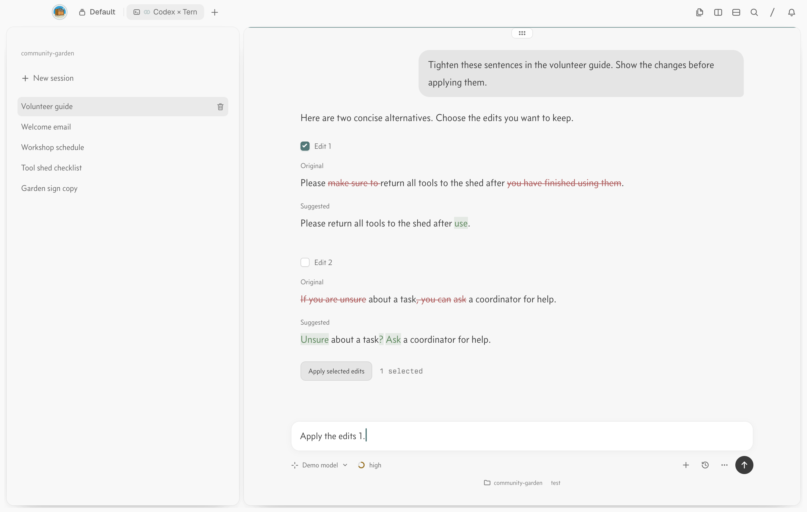

# Codex × Tern

## What is this?

An unofficial Codex GUI built on [Tern](https://stencil.so/tern). The official Codex harness stays in charge of models, tools, approvals, sandboxing, and sessions.

## How it works

TypeScript and Bun connect to the official `codex app-server` over stdio JSON-RPC. The [Tern Surface Protocol SDK](https://docs.stencil.so/tern/protocol/sdks.html) renders the interface natively. Your existing Codex login and configuration carry over.



## Use it

Get access to [Tern](https://stencil.so/tern) (currently in closed beta), install [Bun](https://bun.com/docs/installation) 1.4.3+, and install the official [Codex CLI](https://github.com/openai/codex). Sign in with `codex login` and make sure `tern` and `codex` are on your PATH.

Clone this repository, then run:

```sh
cd codex-tern
bun install --frozen-lockfile
bun run build
bun link
codex-tern setup  # Register the sessions sidebar and appearance styles
```

From any project directory:

```sh
codex-tern
# Or choose a project:
codex-tern -C /path/to/project
```

[Usage and appearance](docs/usage.md) · [Writing proposal format](docs/proposals.md) · [Changelog](CHANGELOG.md) · [Development](docs/development.md)
